# booking-and-more — Felhasználói útmutató

_Közérthető útmutató a booking-and-more használatához: mit csinál az egyes képernyő, ki mit tehet meg, hogyan jut el egy időpontfoglalás az ügyfél telefonjától a csapat napi teendőiig, és hogyan válaszol az AI recepciós az Ön nevében._

---

## Mi ez, egy mondatban?

Ez az **Ön saját online foglalási oldala és AI recepciósa, mögötte egy irányítópulttal, ahol a csapata a naptárat kezeli** — így az ügyfelek hajnali kettőkor is lefoglalhatják az időpontjukat, űrlapon vagy chatben, a munkatársai pedig teljes kontroll alatt tartják, ki mikor és mire érhető el.

A platformon minden vállalkozás teljesen elkülönül a többitől: a szolgáltatásai, a munkatársai, a helyszínei, az ügyfelei és a beszélgetései. Senki más nem látja őket.

**Klinikák, szalonok és stúdiók** számára készült — mindenhová, ahol az emberek egy megnevezett személyhez foglalnak időt egy megnevezett szolgáltatásra.

---

## A termék részei

### 1. A nyilvános foglalási oldal 🌐

Egy oldal a vállalkozása saját címén — `vallalkozas.example.com/azonosito/book` —, amelyet bárki megnyithat fiók nélkül. Öt rövid lépésben kiválasztják a szolgáltatást, azt, hogy kihez mennének, egy időpontot egy valódi naptárból, megadják az adataikat, és kész a foglalás. Azonnal kapnak egy e-mailt egy linkkel, amellyel módosíthatják vagy lemondhatják az időpontot.

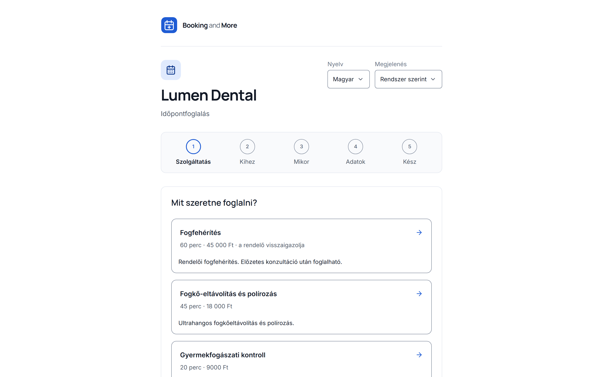

### 2. Az AI recepciós 💬

A **Professional** csomagokban az ügyfelek egyszerűen _kérdezhetnek is_. Egy chatoldal a `…/azonosito/chat` címen — és ha szeretné, egy chatbuborék a saját weboldalán — válaszol a szolgáltatásokkal, árakkal, munkatársakkal, helyszínekkel és szabályzatokkal kapcsolatos kérdésekre, szabad időpontot keres, és lefoglalja az időpontot. Ugyanabból a naptárból és ugyanazokkal a szabályokkal dolgozik, mint a foglalási űrlap, és az űrlap mindig egy koppintásnyira van.

### 3. A munkatársi irányítópult 💻

Itt jelentkezik be a csapata. Itt található a kínálat (szolgáltatások, munkatársak, helyszínek), az egyes szolgáltatók munkaideje, a napi foglalások listája, és — a Professional csomagokban — az, amit az AI recepciós tud, valamint minden beszélgetése. A csapat elfogadja a kéréseket, átütemez, lemond, és jelöli, ki jelent meg és ki nem.

Minden ugyanazt a naptárt olvassa, így soha nincs egy második, külön karbantartandó naptár.

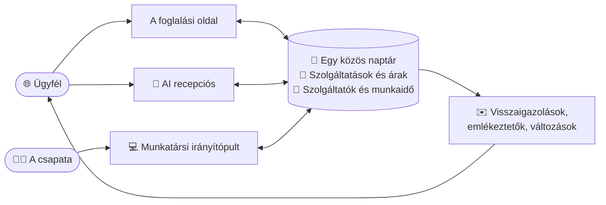

---

## Első lépések — hogyan jutott idáig

A booking-and-more-ra nem lehet önállóan regisztrálni. **Mi állítjuk be a vállalkozását, és e-mailben küldünk meghívót.** Ez szándékos: így a vállalkozás neve, webcíme és nyelve már az első képernyőtől kezdve helyes.

A teljes út a meghívó e-mailtől a működő foglalási oldalig:

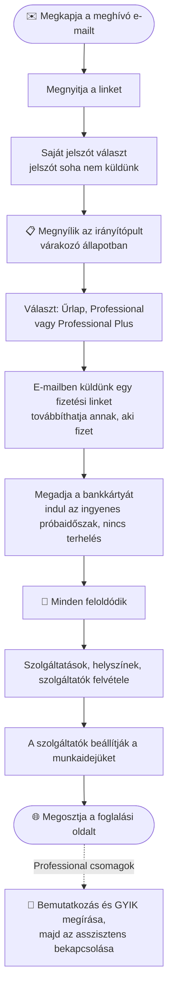

### A meghívó

A meghívóban lévő link **egyszer használható és időkorlátos**. Nyissa meg, válasszon jelszót, és már bent is van — Ön lesz a vállalkozás **tulajdonosa**. Ha már van fiókja nálunk, a meglévő jelszavával egy lépésben elfogadhatja.

Ha a megnyitáskor valaki másként van bejelentkezve, a képernyő ezt egyértelműen jelzi, és felajánlja, hogy előbb kijelentkezteti. Ha a link elévült, kérjen újat — egy friss link másodpercek alatt elkészül, a régi pedig onnantól nem működik.

### A várakozó állapot

Amíg az előfizetés el nem indul, az irányítópult a teljes termék helyett egy rövid üdvözlőképernyőt mutat:

> **Üdvözöljük, {a vállalkozás neve}**
> A vállalkozása be van állítva, és az előfizetésre vár. Íme, mi következik.

Felsorolja a három következő lépést — előfizetés, beállítás, foglalások fogadása —, és visszaszámolja, hány nap van még az előfizetésig. **A szolgáltatók, szolgáltatások, helyszínek, elérhetőség és foglalások az előfizetés elindítása után válnak elérhetővé.** Addig csak két képernyő működik: ez az áttekintés, és az Előfizetés, amely feloldja a többit.

---

## Az előfizetés

Nyissa meg az **Előfizetés** menüpontot az oldalsávban. Három csomagot lát:

| Csomag                | Mire való                                                                                                         |  Havi díj |
| --------------------- | ----------------------------------------------------------------------------------------------------------------- | --------: |
| **Űrlap**             | Irányítópult és nyilvános foglalási űrlap. Az AI chat nem része a csomagnak.                                      |  9 990 Ft |
| **Professional**      | Az Űrlap csomag, plusz AI chat, weboldali widget és beszélgetési naplók. Havi 150, legfeljebb napi 30 beszélgetés | 29 900 Ft |
| **Professional Plus** | A Professional minden funkciója, havi 300, legfeljebb napi 30 beszélgetéssel                                      | 59 800 Ft |

Az árak **alanyi adómentesek (AAM) — áfát nem számítunk fel**. A számlák a Billingo rendszerében készülnek.

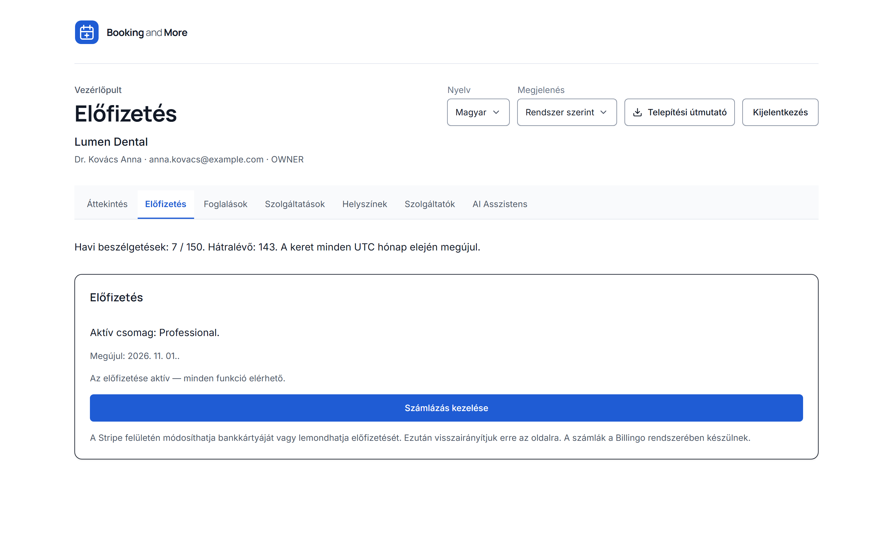

Válasszon csomagot, és nyomja meg a **Kérem a fizetési linket** gombot. E-mailben küldünk egy biztonságos fizetési oldalt — továbbíthatja annak, aki a pénzügyeket intézi; ezért érkezik e-mailben, és nem nyílik meg azonnal.

> **Segítség kellene az induláshoz?** Az egyszeri, támogatott beállítás díja 29 990 Ft — ilyenkor együtt építjük fel a kínálatát és a beosztásokat.

### Mi számít egy beszélgetésnek

Egy beszélgetés akkor számít, amikor az ügyfél **elindít** egy chatet az AI recepcióssal — egyszer, akármeddig tart, és akkor is, ha félbehagyja. A chatoldal megnyitása, frissítése vagy a nyelv váltása nem számít újra. A fel nem használt beszélgetések nem vihetők át, és **nincs meglepetésszerű túlhasználati díj**: ha a havi keret elfogy, a chat ezt jelzi, a foglalási űrlap pedig ugyanúgy működik tovább. Professional csomagban az Előfizetés képernyő mutatja az aktuális állást:

> _Havi beszélgetések: {used} / {limit}. Hátralévő: {remaining}. A keret minden UTC hónap elején megújul._

### Az ingyenes próbaidőszak

Az új vállalkozások **30 nap ingyenes próbaidőszakot** kapnak. A kártyát az elején rögzítjük, de **a próbaidőszak végéig semmit nem terhelünk**, és addig bármikor lemondhatja. A képernyő pontosan megmutatja, meddig: _„Az ingyenes próbaidőszak {dátum} napján ér véget. Ezt követően a(z) {csomag} csomag díját számítjuk fel.”_

Egy vállalkozás csak egyszer kaphat próbaidőszakot. Ha már felhasználta, a képernyő ezt jelzi, és a számlázás azonnal indul.

### Az előfizetés után

Az Előfizetés képernyő lesz a számlázási központja:

- A **Számlázás kezelése** a Stripe biztonságos felületét nyitja meg, ahol bankkártyát cserélhet vagy lemondhatja az előfizetést. Utána visszairányítjuk ide.
- **Csomagváltás** — a magasabb csomagra váltás azonnal érvényes; az alacsonyabbra váltás az időszak végére ütemeződik, és a képernyő megmutatja a dátumot: _„A csomag {dátum} napján a következőre vált: {csomag}.”_
- **Lemondás** esetén nem szakad meg a szolgáltatás hónap közben. A képernyőn ez áll: _„Lejár: {dátum}.”_, és addig bármikor újraindíthatja.
- **Egy sikertelen fizetés** nem kapcsol ki azonnal semmit. Egy értesítés kéri, hogy frissítse a bankkártyaadatait, miközben a szolgáltatás tovább működik.

---

## Az Áttekintés képernyő — a kezdőlap

Bejelentkezés után az **Irányítópult → Áttekintés** fogadja. Fentről lefelé:

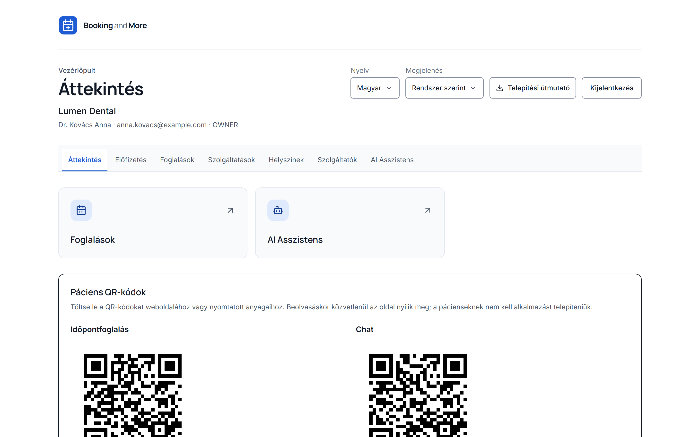

- **Gyorsgombok** a naponta használt képernyőkhöz — Foglalások, Elérhetőség és Professional csomagban AI Asszisztens. Csak azokat látja, amelyekhez hozzáfér.
- **Páciens QR-kódok** — letölthető kódok a weboldalára, az ajtajára vagy a nyomtatott anyagaira. A beolvasás közvetlenül a foglalási oldalt nyitja meg; Professional csomagban egy második kód a chatet. **Az ügyfeleknek semmit nem kell telepíteniük.**
- **Amit az AI recepciós tud** _(Professional csomagok)_ — a vállalkozás bemutatkozása, a gyakori kérdések, az elérhetőségek és a tudásellenőrzés. Ennek saját fejezete van lentebb, _Az AI recepciós_ címmel.
  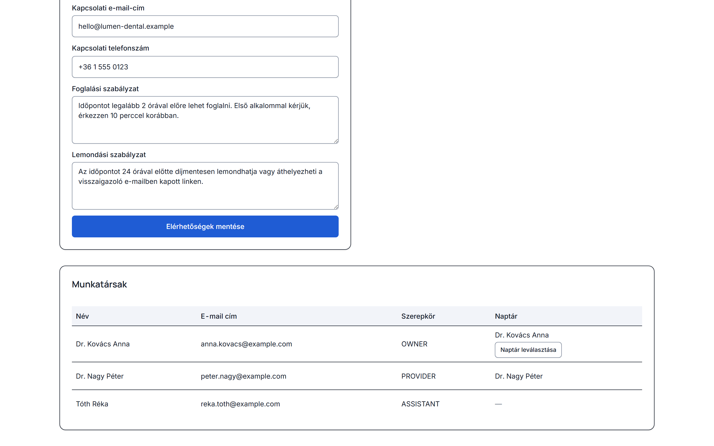

- **Munkatársak** — mindenki, akinek van belépése, a szerepköre, és **hogy melyik naptár az övé**. Az a szolgáltató, akinek a sorában _„Nincs naptár — még nem tud dolgozni”_ áll, be tud jelentkezni, de semmit nem tud csinálni; ott helyben rendelje hozzá a naptárához.

Ha Ön több vállalkozáshoz is tartozik, a felül lévő **Válasszon vállalkozást…** választóval válthat közöttük. Mindegyiknek saját szerepköre, saját adatai és saját oldalsávja van.

---

## A kínálat felépítése

Három képernyő, és a sorrend számít. **Először a szolgáltatások, aztán a helyszínek, végül a szolgáltatók** — mert egy szolgáltatóhoz mindig _egy szolgáltatásra_ foglalnak, így egy elsőként létrehozott szolgáltatónak nincs mit kínálnia, és meg sem jelenhet a foglalási oldalon.

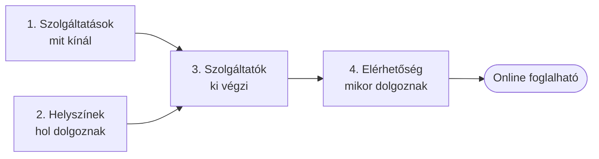

---

## Szolgáltatások — amit kínál

**Irányítópult → Szolgáltatások → Szolgáltatás hozzáadása.**

Egy szolgáltatás egy foglalható dolog: egy kontrollvizsgálat, egy vágás és festés, egy 50 perces alkalom.

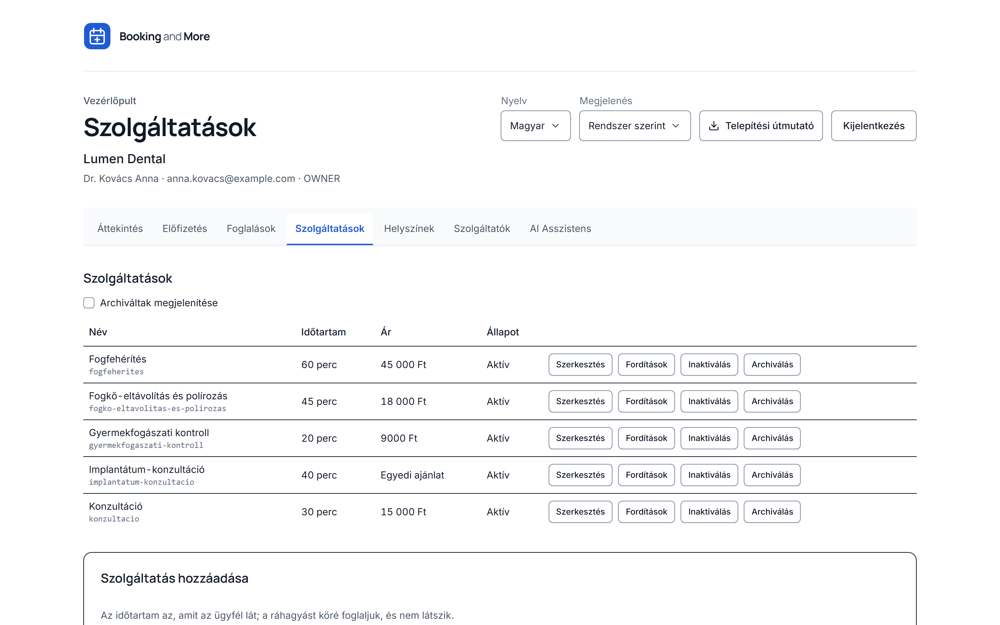

| Mező                        | Mire való                                                                                                   |
| --------------------------- | ----------------------------------------------------------------------------------------------------------- |
| **Név** és **Leírás**       | Amit az ügyfél a foglalási oldalon olvas — és amit az AI recepciós is olvas                                 |
| **Időtartam**               | Milyen hosszú az időpont — **ezt látja az ügyfél**                                                          |
| **Ráhagyás előtte / utána** | Az időpont köré foglalt percek. **Az ügyfelek soha nem látják őket** — takarításra vagy jegyzetelésre valók |
| **Ár**                      | Ha üresen hagyja, a foglalási oldalon _„Egyedi ajánlat”_ jelenik meg                                        |
| **URL-név**                 | A foglalási linkekben jelenik meg. Ha üresen hagyja, a névből képezzük                                      |

**Rövid és részletes leírás.** Először írjon rövid leírást, majd egy külön sorba írt `---` után a részletes leírást. A foglalási oldal a rövidet mutatja, a többit az ügyfél kinyithatja.

### A három beállítás, amelyet érdemes megérteni

**Jóváhagyást igényel a megerősítés előtt.** Ha bekapcsolja, a foglalások _kérésként_ érkeznek, nem erősödnek meg azonnal. Az ügyfél azt az üzenetet kapja, hogy a vállalkozás hamarosan visszaigazolja, az időpont pedig a Foglalások képernyőn vár, amíg valaki el nem fogadja. Ott használja, ahol át szeretné nézni, ki jön; ahol megfelel az automatikus foglalás, hagyja kikapcsolva.

**Legkorábbi foglalás (perc).** Milyen közel az időponthoz lehet még foglalni. Ha 120-ra állítja, senki nem foglalhat két órán belüli időpontot.

**Előre foglalható (nap).** Milyen messzire a jövőbe van nyitva a naptár.

Az utóbbi kettő üresen hagyható, ekkor a vállalkozás egészére érvényes beállítást **örökli**. Figyelem: az _üres_ és a _nulla_ nem ugyanaz. Az üres azt jelenti: „használd az alapértelmezettet”; a nulla azt: „az utolsó pillanatig foglalható”. A képernyő megmutatja, melyik alapértelmezést örökli, és figyelmeztet, ha olyan szűk ablakot állított be, hogy az ügyfelek szinte semmit nem fognak látni.

### Fordítások

A szolgáltatás sorában lévő **Fordítások** tartalmazza a nevét és a leírását magyarul, angolul, németül és franciául. Az az ügyfél, aki más nyelven olvassa az oldalt — vagy chatel —, az adott nyelvű változatot látja; ha nincs ilyen, az alapnyelvűt.

Professional csomagban minden nyelvnél van egy **fordítás** gomb, amely gépi fordítással tölti ki a mezőket az alapnyelvből. **A fordítás semmit nem ment el** — olvassa el, javítsa, és csak utána mentse.

### Kikapcsolás

Két különböző kérdés, mindkettő elérhető:

- **Inaktiválás** — egyelőre kikapcsolva. Eltűnik a foglalási oldalról, és bármikor visszakapcsolható.
- **Archiválás** — végleges. Teljesen eltűnik a munkalistából.

**Ténylegesen soha semmi nem törlődik.** A régi időpontok továbbra is arra a szolgáltatásra mutatnak, amelyre foglalták őket, így az előzmények épek és helyesen árazottak maradnak. Az **Archiváltak megjelenítése** bejelölésével látja az archivált sorokat, a **Visszaállítás** gombbal pedig visszahozhatja őket. Ha létrehozáskor azt a választ kapja, hogy a név foglalt, az többnyire egy archivált sor — állítsa vissza, ne hozzon létre másolatot.

---

## Helyszínek — ahol dolgoznak

**Irányítópult → Helyszínek → Helyszín hozzáadása.**

Egy helyszín a vállalkozás egyik telephelye. Négyféle van:

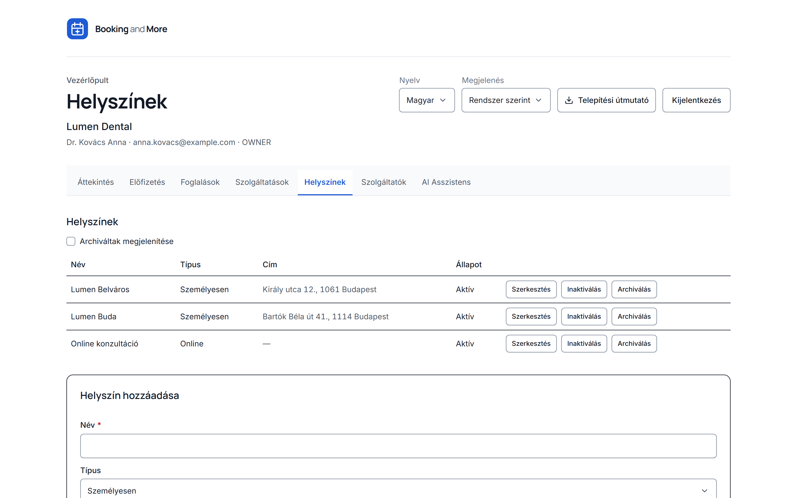

| Típus                | Mire használja                          |
| -------------------- | --------------------------------------- |
| **Személyesen**      | Fizikai cím, ahová az ügyfelek elmennek |
| **Online**           | Videós időpontok                        |
| **Házhoz kiszállás** | Ön megy az ügyfélhez                    |
| **Telefonos**        | Telefonos konzultációk                  |

Fizikai telephelynél adja meg a címet, irányítószámot, várost és országot. A **térkép-koordináták** opcionálisak; segítségükkel a foglalási oldal a megfelelő pontra mutat.

Az **időzóna** külön említést érdemel: ha üresen hagyja, a helyszín a vállalkozás saját időzónáját használja. Csak akkor állítsa be, ha valóban egy másik időzónában működtet telephelyet — az ottani időpontok ekkor abban a zónában jelennek meg.

> **Lehet, hogy egyáltalán nincs szüksége helyszínre.** Ha minden online vagy telefonon zajlik, ezt a képernyőt teljesen kihagyhatja. A helyszín azt írja le, hol dolgozik valaki fizikailag; a foglaláshoz nem szükséges.

---

## Szolgáltatók — akikhez az ügyfelek foglalnak

**Irányítópult → Szolgáltatók → Szolgáltató hozzáadása.**

A szolgáltató az, akihez az időpontokat foglalják. Fontos: **egy szolgáltató létrehozása nem ad neki belépést** — ez külön lépés, lentebb olvashat róla.

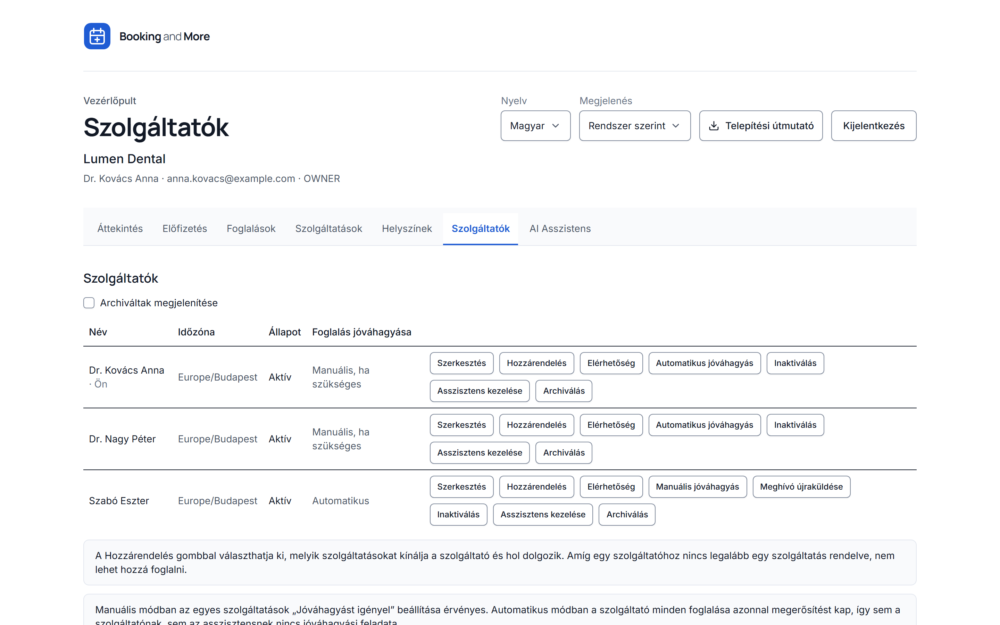

| Mező                         | Mire való                                                                                                                   |
| ---------------------------- | --------------------------------------------------------------------------------------------------------------------------- |
| **Név, e-mail, telefonszám** | Az adatlapja. Meghívót is erre az e-mail címre küldünk                                                                      |
| **Beszélt nyelvek**          | Magyar, angol, német, francia — az ügyfelek választását segíti                                                              |
| **Online foglalható**        | Kapcsolja **ki**, ha valakit le szeretne venni a nyilvános foglalási oldalról, miközben a csapat telefonon még foglal hozzá |
| **Alapértelmezett helyszín** | Ahol általában dolgozik                                                                                                     |

### Szolgáltatások hozzárendelése

Ezt a lépést szokták elfelejteni. **Amíg egy szolgáltatóhoz nincs legalább egy szolgáltatás rendelve, nem lehet hozzá foglalni** — egyszerűen nem jelenik meg a foglalási oldalon.

A szolgáltató sorában lévő **Hozzárendelés** gombbal jelölje be, mely szolgáltatásokat kínálja. Közben felülírhatja a szolgáltatás saját beállításait erre az egy személyre:

- **Időtartam** — üresen hagyva a szolgáltatás sajátját használja. Akkor állítsa be, ha ennek a szolgáltatónak 45 perc kell ott, ahol mindenki másnak 30.
- **Ár** — üresen hagyva örökli. (Ha a szolgáltatásnak egyáltalán nincs ára, nincs mit felülírni, és a képernyő ezt jelzi.)

A **Hozzárendelés** az a hely is, ahol az alapértelmezett mellé további helyszíneket adhat, így egy szolgáltató dolgozhat kedden az egyik telephelyen, csütörtökön a másikon.

### Foglalás jóváhagyása, szolgáltatónként

Minden szolgáltatónak van egy **Foglalás jóváhagyása** módja:

- **Manuális** — az egyes szolgáltatások „Jóváhagyást igényel” beállítása érvényes.
- **Automatikus** — a szolgáltató minden foglalása azonnal megerősítést kap, bármit mond a szolgáltatás, így sem a szolgáltatónak, sem az asszisztensének nincs jóváhagyási feladata.

### Belépéssel rendelkező szolgáltató archiválása

Egy szolgáltató archiválása elrejti a naptárát, és leveszi a foglalási oldalról. Ha valaki **ezzel a szolgáltatóval jelentkezik be**, a megerősítő ablak figyelmeztet, hogy a visszaállításig nem fér hozzá sem az elérhetőségéhez, sem a foglalásaihoz — ha csak egy időre venné le a foglalási oldalról, inkább **inaktiválja**, így a belépése működik tovább.

---

## Elérhetőség — mikor dolgoznak

**Az elérhetőség a szolgáltatóé.** Ez tudatos döntés, nem a felépítés véletlene: a tulajdonos dönti el, mit és hol kínál a vállalkozás, és minden szolgáltató maga dönti el, mikor dolgozik.

Ezért nincs vállalkozás szintű elérhetőség képernyő. A belépéssel rendelkező szolgáltató megnyitja az **Elérhetőség** menüpontot, és a saját naptárát látja. A tulajdonos vagy adminisztrátor bármelyik naptárt — a sajátját is, ha maga is rendel — a Szolgáltatók képernyőn, az adott szolgáltató sorában lévő **Elérhetőség** gombbal éri el.

A képernyőnek három füle van: **Heti munkaidő**, **Kivételek** és — a tulajdonosnak — **Megbízottak**.

### Heti munkaidő

Egy szokásos hét. Minden naphoz adjon meg egy vagy több időszakot.

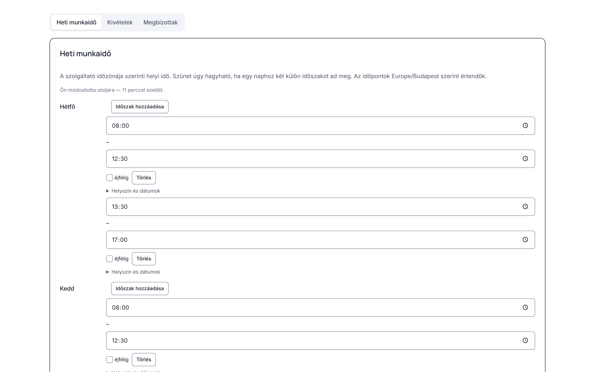

**Ha egy naphoz második időszakot ad, szünet marad közöttük** — a 09:00–12:30 és 13:30–17:00 olyan ebédidőt ad, amelyre senki nem foglalhat. Az a nap, amelyen nincs időszak, egyszerűen zárva van.

Az idők **helyi idők a szolgáltató saját időzónájában**, és a képernyő megmutatja, melyik ez. Ez évente kétszer számít: a „hétfőnként 09:00–17:00” az óraátállítás hétfőjén is 09:00–17:00 marad, ahogy egy ember elvárná.

Minden időszak tovább szűkíthető:

- **Helyszín** — hol dolgozik ebben az időszakban, vagy _„Ahol dolgozik”_
- **Szolgáltatás** — az időszak egy szolgáltatásra korlátozása, vagy _„Minden szolgáltatás”_
- **Kezdő / záró dátum** — olyan időszak, amely csak az év egy részében érvényes

Ha a szolgáltatóhoz még nincs szolgáltatás rendelve, a képernyő ezt már az elején jelzi — a munkaidő önmagában nem eredményez foglalható időpontot.

### Kivételek — egyszeri változások

Amit egy heti minta nem tud kifejezni. **A kivételek felülírják a heti munkaidőt.**

- **Nem elérhető** — zárás. Ünnepnap, képzési nap, egy délután a fogorvosnál.
- **Plusz elérhetőség** — a szokásos mintán kívüli nyitás. Egy szombati rendelés, egy késő esti alkalom.

Adjon meg **indoklást**, ha segít a csapatnak; az indoklást **csak a munkatársak látják, az ügyfelek soha**.

Ha olyan időpontot választ, amelyet az óraátállítás „elnyelt”, a képernyő szól, ahelyett hogy csendben találgatna: _„Ez az időpont nem létezik azon a napon — ekkor van az óraátállítás.”_ Visszaállításkor pedig: _„Ez az időpont kétszer fordul elő azon a napon.”_

### Két biztonsági háló

**A munkaidőn kívülre kerülő foglalások.** Ha lerövidít egy hetet, amelyben már vannak foglalások, a mentés nem hiúsul meg — megáll, és pontosan megmutatja, mely időpontok esnek most a munkaidőn kívülre:

> _Ezek az időpontok érvényben maradnak, és továbbra is foglalják a helyet. A mentés nem mondja le és nem helyezi át őket — csak annyit jelent, hogy a beosztás már nem fedi le őket._
> _Erről senki nem kap e-mailt. Ha egy időpontot át kell helyezni vagy le kell mondani, tegye meg a Foglalások oldalon._

A **Mentés mindenképp** gombbal folytathatja, a **Vissza** gombbal átgondolhatja. A rendszer figyelmeztet, de nem tilt — a tiltás ugyanis arra kényszerítené, hogy valódi ügyfeleket mondjon le csak azért, hogy a beosztását módosíthassa.

**Ha valaki más is szerkeszti ugyanazt a naptárt.** Ha egy szolgáltató és az asszisztense egyszerre nyitja meg ugyanazt a hetet, a másodikként mentő ezt az üzenetet kapja:

> _{név} mentette ezt a beosztást {mikor}, miközben Ön szerkesztette. Amit beírt, abból semmi nem mentődött el._

Semmi nem íródik felül csendben. **Az ő változatuk betöltése** lecseréli a képernyő tartalmát — előbb másolja ki, amire még szüksége van. A képernyő tetején egy halvány sor azt is mutatja, ki és mikor módosította utoljára a beosztást.

---

## Belépés adása a csapatnak

Háromféleképpen kaphat valaki hozzáférést, és mindegyik ott történik, ahol a rendszer tudja, mire lesz szüksége az illetőnek.

| Kit                                        | Honnan hívja meg                                                          | Mit visz magával a meghívó                 |
| ------------------------------------------ | ------------------------------------------------------------------------- | ------------------------------------------ |
| **Szolgáltatót**                           | Szolgáltatók → a sora → **Meghívás**                                      | A saját naptárát                           |
| **Recepcióst / asszisztenst**              | Egy szolgáltató Elérhetősége → **Megbízottak** → **Új személy meghívása** | Azokat a naptárakat, amelyeket kezelni fog |
| **Másik tulajdonost vagy adminisztrátort** | Áttekintés → **Tulajdonos vagy adminisztrátor meghívása**                 | Naptárt nem — ő a vállalkozást kezeli      |

Minden meghívó **e-mailben küldött, egyszer használható link**; a jelszót az illető maga választja — jelszót soha nem küldünk.

### Szolgáltató meghívása

**Szolgáltatók képernyő → a szolgáltató sora → Meghívás.** A meghívó **magával viszi a naptárát**. Az elfogadás után:

> _Ez a naptár az övé lesz: beállíthatja a munkaidejét, felvehet szabadságot, és láthatja a saját foglalásait._

E-mail cím nélküli szolgáltatót nem lehet meghívni; előbb vegye fel a címét az adatlapján. Ha már van élő meghívó, a képernyő figyelmeztet, hogy egy újabb elküldése érvényteleníti az elsőt. Ha az e-mail nem érkezik meg, az **Inkább a link megjelenítése** egyszer megmutatja a linket, hogy Ön adhassa át.

### Ha a tulajdonos maga is rendel

Sok tulajdonos maga is szakember. Ehhez nem kell második fiók vagy második szerepkör: vegye fel magát szolgáltatóként a Szolgáltatók képernyőn, majd az **Áttekintés → Munkatársak** listában, a saját sorában válassza a **Rendel is? Naptár hozzárendelése…** lehetőséget. Tulajdonos marad, mellette saját naptárral — amelyet, mint mindenki másét, a Szolgáltatók képernyőn a saját sorából ér el. A **Naptár leválasztása** visszavonja; a naptár és a foglalásai megmaradnak.

Egy szabály itt szigorú: **aki a platformon egy vállalkozás tulajdonosa, az egy másik vállalkozásnál nem dolgozhat szolgáltatóként, és fordítva.** Ha egy meghívó ezt sértené, az elfogadást a rendszer magyarázattal elutasítja — a másik vállalkozáshoz használjon külön fiókot.

---

## Ki mit tehet

Négy szerepkör. Mindegyik egy **tagsághoz** tartozik — vagyis egy személyhez _egy adott vállalkozásban_. Ugyanaz a személy lehet az egyik klinikán adminisztrátor, a másikon asszisztens, teljesen eltérő jogosultságokkal.

|                                                       | Tulajdonos | Adminisztrátor | Szolgáltató | Asszisztens |
| ----------------------------------------------------- | :--------: | :------------: | :---------: | :---------: |
| Számlázás és előfizetés                               |     ✅     |       —        |      —      |      —      |
| Vállalkozási beállítások, elérhetőségek, szabályzatok |     ✅     |       —        |      —      |      —      |
| Tagok meghívása és kezelése                           |     ✅     |       ✅       |      —      |      —      |
| Szolgáltatások, helyszínek, szolgáltatók              |     ✅     |       ✅       |      —      |      —      |
| AI recepciós: beállítások, bemutatkozás, GYIK         |     ✅     |       ✅       |      —      |      —      |
| AI recepciós: beszélgetések olvasása                  |     ✅     |       ✅       |      —      |      —      |
| **Bárki** munkaidejének szerkesztése                  |     ✅     |       ✅       |      —      |      —      |
| **Saját** munkaidő szerkesztése                       |     ✅     |       ✅       |     ✅      |      —      |
| **Rábízott** naptár munkaidejének szerkesztése        |     —      |       —        |      —      |     ✅      |
| **Minden** foglalás megtekintése és kezelése          |     ✅     |       ✅       |      —      |      —      |
| **Saját** foglalások megtekintése és kezelése         |     ✅     |       ✅       |     ✅      |      —      |
| **Rábízott** foglalások megtekintése és kezelése      |     —      |       —        |      —      |     ✅      |
| **Annak eldöntése, ki segít egy naptárnál**           |     ✅     |       —        |      —      |      —      |

Két sor érdemel külön figyelmet.

**Az adminisztrátor a klinika minden beosztását szerkesztheti, mégsem döntheti el, ki segít egy naptárnál.** Ez szándékos. Egy naptár szerkesztése napi munka; a hozzá tartozó kulcsok átadása munkaszervezési döntés, az pedig a tulajdonosé.

**Az asszisztens csak a rábízott naptárakat éri el, másokat nem.** Nem „minden foglalást” — csak azokat a konkrét naptárakat, amelyeket valaki átadott neki. Amíg nem kapott egyet sem, a Foglalások képernyője üres, és az oldalsávban meg sem jelenik. Ez nem hiba: a recepció pontosan azt a hozzáférést kapta, amit adtak neki.

> **Az oldalsáv csak azt mutatja, amit ténylegesen használni tud.** Azok a képernyők, amelyekhez nincs jogosultsága, nem jelennek meg, és azok sem, amelyek üresek lennének — a Foglalások naptár nélkül, az Elérhetőség saját naptár nélkül. Egy szolgáltató három menüpontot lát, egy tulajdonos mindet. Ha valaki azt mondja, hogy „hiányzik” egy képernyő, az többnyire egy még ki nem osztott naptárt jelent.

---

## Naptár megosztása — megbízottak

A recepciónak azokat a naptárakat kell látnia, amelyeket kezel, és csak azokat. Erre szolgálnak a megbízottak.

**Ezt csak a tulajdonos teheti meg.** Nyissa meg egy szolgáltató **Elérhetőség** képernyőjét, és váltson a **Megbízottak** fülre.

> _Akik ennél a naptárnál segítenek. Ön választja ki, kik ők, és mit tehetnek._

Nyomja meg a **Megbízott hozzáadása** gombot, válasszon tagot, és jelölje be, mit tehet:

| Hatáskör        | Mit ad                                                                    |
| --------------- | ------------------------------------------------------------------------- |
| **Elérhetőség** | Munkaidő beállítása és szabadság felvétele ennél a naptárnál              |
| **Foglalások**  | A naptár foglalásainak megtekintése, elfogadása, átütemezése és lemondása |

Jelöljön be egyet vagy mindkettőt — egy megbízottnak legalább egy kell. A hozzáférés teljes megszüntetéséhez használja a **Visszavonás** gombot; a következő műveleténél elveszíti.

### Meghívás valakinek, akinek még nincs fiókja

Nincs szükség két lépésre. Nyomja meg az **Új személy meghívása** gombot, adja meg az e-mail címet, és a meghívó magával viszi a naptár-hozzárendelést is. Az elfogadáskor egyszerre kapja meg a tagságát és a naptárát — így soha nem érkezik egy üres irányítópultra, azon tűnődve, mi romlott el.

Egy e-mail címhez vállalkozásonként **egyszerre egy élő meghívó** tartozhat. Ha ugyanazt a személyt egy második naptárhoz is meghívja, az újabb meghívó felváltja az elsőt.

**Egy asszisztens több naptárat is kezelhet** — pontosan erre van szüksége egy négy szolgáltatót kiszolgáló recepciónak.

Egy szolgáltató mindig látja, ki segít a saját naptáránál — csak megváltoztatni nem tudja. A képernyője ezt jelzi is: a tulajdonos dönti el, ki segíthet, tőle kell kérnie a változtatást.

---

## A foglalási oldal — amit az ügyfelek látnak

Az oldal a vállalkozás saját címén érhető el, fiók nélkül. Önmagában a `…/azonosito` cím is működik, és a foglalási oldalra visz — ez jól jön plakátokon, vagy ha telefonon kell bediktálni. Öt lépés:

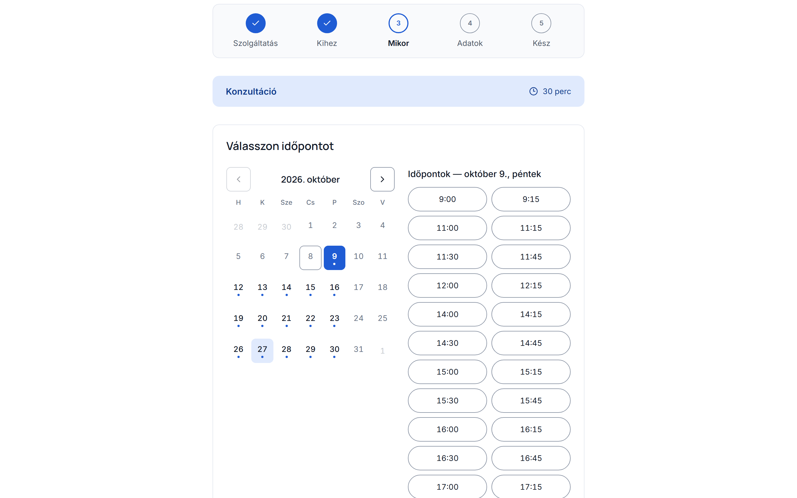

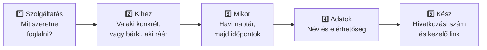

**1. lépés — Szolgáltatás.** Minden, amit aktívra állított, időtartammal és árral. Az ár nélküli szolgáltatásoknál _„Egyedi ajánlat”_ áll. A jóváhagyást igénylő szolgáltatás jelölve van, hogy az ügyfelet később ne érje meglepetés.

**2. lépés — Kihez.** A foglalható szolgáltatók, plusz a **„Bárki, aki ráér”** — ezt választják a legtöbben, és ez a teljes csapat összes szabad időpontját megnyitja.

**3. lépés — Mikor.** Havi naptár. Minden nap mutatja, hány szabad időpont van, így az üres nap már kattintás előtt látszik. Ha egy hónap üres, az oldal nem akad el — előrenéz, és felajánlja a **legközelebbi szabad** napot, akár hónapokkal későbbit is. Csak akkor javasol közvetlen kapcsolatfelvételt, ha valóban nincs semmi.

**4. lépés — Adatok.** Név, e-mail, telefonszám, és bármi, amit tudnia kell. A kötelező mezők jelölve vannak; az e-mail vagy a telefonszám közül legalább az egyik kötelező.

**A kiválasztott időpontot fenntartjuk, amíg gépelnek.** _„Ezt az időpontot {idő} ideig fenntartjuk”_ — nagyjából öt percig. Így nem töltheti ki két ember ugyanarra az időpontra ugyanazt az űrlapot. Ha a fenntartás lejár, újra kell választani; ha pedig valaki más hamarabb véglegesít, egyértelmű üzenetet kapnak — _„Valaki épp lefoglalta ezt az időpontot. Íme a még szabad időpontok.”_ —, ahelyett hogy a legelejére kerülnének vissza.

**5. lépés — Kész.** Egy hivatkozási szám és egy link a foglalás kezeléséhez. Ha a szolgáltatás jóváhagyást igényel, helyette ez áll: _„A rendelő hamarosan visszaigazolja az időpontot.”_

> A kezelő link az **egyetlen** módja annak, hogy az ügyfél online módosítsa a foglalását. Az e-mailben is benne van — de az oldal nem véletlenül kéri: _„Mentse el ezt a linket is.”_ Csak egy titkosított kivonatát tároljuk, így ha elveszik, nem állítható helyre és nem küldhető újra; ilyenkor a foglalást a munkatársaknak kell módosítaniuk.

### Mit tehet az ügyfél ezzel a linkkel

Megnyitva látja a foglalását — állapot, időpont, hely, szolgáltatás, szolgáltató, ár — és két műveletet:

- **Időpont módosítása.** Új időpontot javasol, és az oldal véglegesítés előtt ellenőrzi: _„Az időpont áthelyezhető erre: {idő}.”_ Ha nem lehetséges, azt a tanácsot kapja, hogy hívja fel Önöket, ahelyett hogy találgatna.
- **Lemondás.** Egyértelmű figyelmeztetéssel, hogy ezzel másnak szabadítja fel az időpontot, és nem vonható vissza.

A már lemondott vagy megtörtént időpont lezárt; az oldal ezt jelzi, ahelyett hogy olyan gombokat kínálna, amelyek úgysem működnének.

---

## Amit az ügyfelek e-mailben kapnak

Öt e-mail, mind az ügyfél saját nyelvén:

| E-mail                      | Mikor                                                         | Van benne kezelő link?                    |
| --------------------------- | ------------------------------------------------------------- | ----------------------------------------- |
| **Foglalási kérés**         | Azonnal, jóváhagyást igénylő szolgáltatásnál                  | ✅                                        |
| **Foglalás visszaigazolva** | Megerősítéskor, vagy amikor a munkatársak elfogadják a kérést | ✅ (plusz _Hozzáadás a Google Naptárhoz_) |
| **Foglalás módosult**       | Amikor az időpont változik                                    | —                                         |
| **Foglalás lemondva**       | Lemondáskor                                                   | —                                         |
| **Emlékeztető**             | 24 órával az időpont előtt                                    | —                                         |

Ugyanezek az e-mailek mennek ki, akár űrlapon, akár chatben foglalt az ügyfél.

A visszaigazoló e-mailben van egy **Hozzáadás a Google Naptárhoz** gomb. Ez egy egykattintásos előkitöltés — semmit nem köt össze a rendszerével, és szándékosan csak a visszaigazolásban szerepel: egy átütemezési e-mailben egy _második_ bejegyzést hozna létre valakinek a naptárában, ahelyett hogy a meglévőt helyezné át.

A **lemondási szabályzatát**, ha megadott ilyet, pontosan úgy tüntetjük fel a visszaigazoláson, ahogyan megírta.

---

## A nap irányítása — a Foglalások képernyő

**Irányítópult → Foglalások.** Ezen a képernyőn dolgozik a csapata nap mint nap.

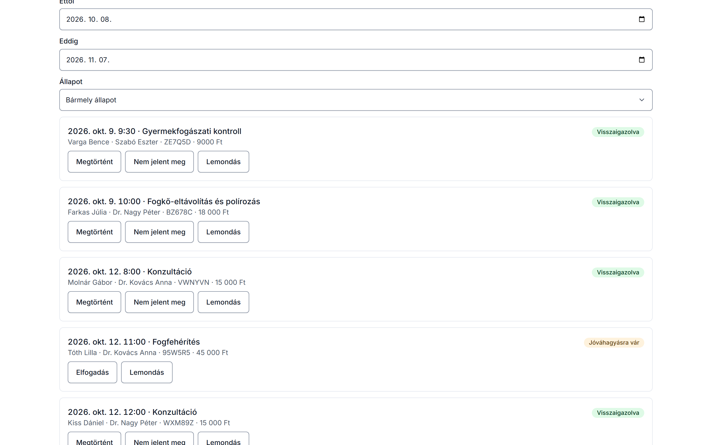

Szűrhet **dátumtartományra**, **szolgáltatóra** — _„Mindenki”_, vagy _„Minden naptáram”_, ha asszisztensként több naptárat kezel — és **állapotra**.

| Állapot              | Jelentése                                    |
| -------------------- | -------------------------------------------- |
| **Jóváhagyásra vár** | Kérés egy jóváhagyást igénylő szolgáltatásra |
| **Visszaigazolva**   | Megtartjuk                                   |
| **Lemondva**         | Elmarad                                      |
| **Megtörtént**       | Lezajlott                                    |
| **Nem jelent meg**   | Az ügyfél nem jött el                        |
| **Lejárt**           | Egy soha be nem fejezett fenntartás          |

Minden sorban négy művelet van: **Elfogadás** (a kérésből visszaigazolt időpont lesz, és az ügyfél e-mailt kap), **Megtörtént**, **Nem jelent meg** és **Lemondás**. Ami nem vonható vissza, előbb megerősítést kér.

Figyeljen a **Beosztáson kívül** jelzésre. Azt jelzi, hogy egy időpont már nem esik a szolgáltató munkaidejébe, vagy szabadság alá került. Az időpont továbbra is valós, és foglalja a helyet — a jelzés csak azt mondja, hogy alatta megváltozott a beosztás, és valakinek döntenie kell, mi legyen vele.

---

## Az AI recepciós

_Professional és Professional Plus csomag._ A tulajdonos és az adminisztrátor kezeli; a szolgáltatók és az asszisztensek nem látják.

### Amit az ügyfelek látnak

Egy chat a `…/azonosito/chat` címen, háromféleképpen elérhető: a **chat QR-kóddal** az Áttekintés képernyőről, egy **chatbuborékkal a saját weboldalán** (a beillesztendő kódrészletet kérje tőlünk), vagy egy egyszerű linkkel.

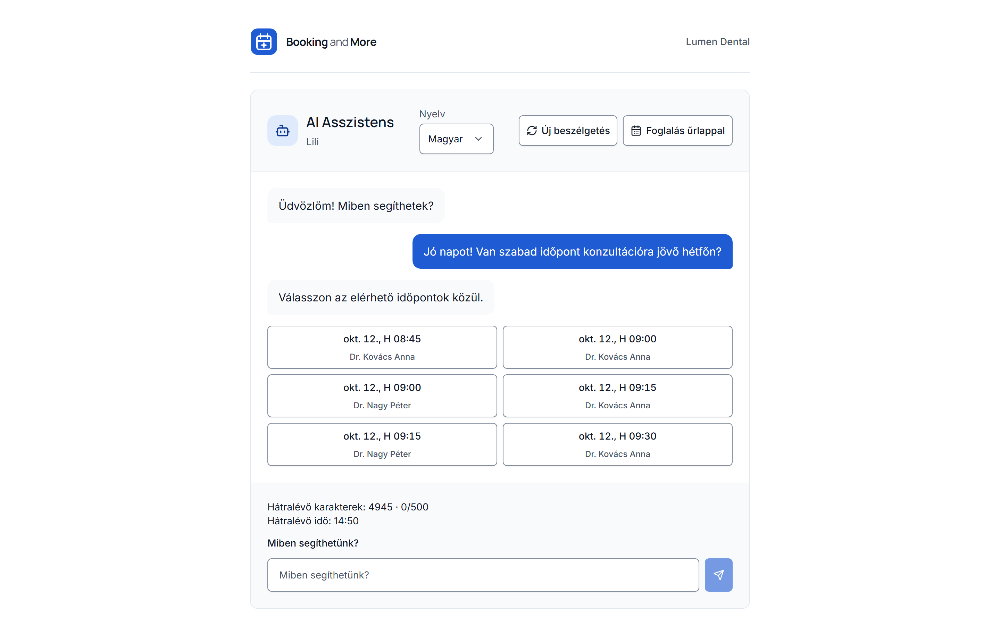

Az ügyfél elindítja a beszélgetést, és ír — vagy rákoppint valamelyik szolgáltatásra, amelyeket az üdvözlő üzenet gombként sorol fel. A recepciós:

- válaszol a **szolgáltatásokkal, árakkal, szolgáltatókkal, helyszínekkel, nyitvatartással, foglalási és lemondási szabályzattal** kapcsolatos kérdésekre, valamint a **gyakori kérdésekre**;
- **szabad időpontot keres**, és gombként kínálja fel — egy koppintás kiválasztja, nem kell begépelni;
- **lefoglalja az időpontot**, pontosan ugyanazzal a fenntartással, szabályokkal és visszaigazoló e-mailekkel, mint a foglalási űrlap.

Az ügyfél tudta nélkül semmi nem történik: mielőtt bármi rögzülne, a chat egy összefoglaló kártyát mutat, és az ügyfél a **Megerősítés** gombbal hagyja jóvá. A **Foglalás űrlappal** gomb végig látható, és ha az asszisztens nem érhető el — ki van kapcsolva, elfogyott a havi keret, vagy technikai hiba van —, a chat ezt jelzi, és az űrlapra irányít, amely tovább működik.

A beszélgetések szándékosan rövidek: mindegyiknek időkorlátja van, látható visszaszámlálással és egyperces figyelmeztetéssel, az üzenetek hossza korlátozott, és gépelni kell őket, beilleszteni nem lehet. Egy meglévő időpont módosítása vagy lemondása az ügyfél **kezelő linkjén** keresztül történik.

A chat **magyarul, angolul, németül és franciául** beszél — azon a nyelven, amelyet az ügyfél használ, az Ön által engedélyezett nyelvek közül.

### Bekapcsolás — az AI Asszisztens képernyő

**Irányítópult → AI Asszisztens.**

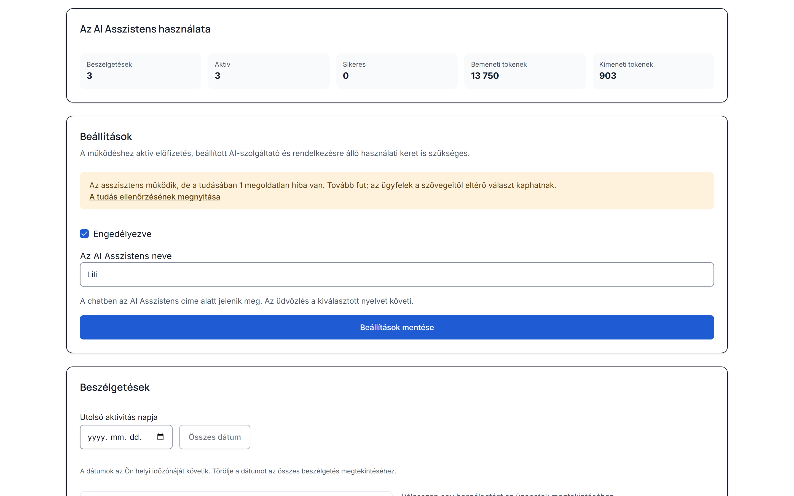

- **Beállítások** — **Engedélyezve**, **az AI Asszisztens neve** (a chat fejléce alatt jelenik meg), a **nyelvek**, amelyeken beszélhet, és a **kapcsolatfelvételi üzenet**, amelyet akkor ad, ha nem tud segíteni.
- **Használat** — a havi beszélgetések, az aktív és sikeres beszélgetések száma, valamint a felhasznált AI-keret.
- **Beszélgetések** — minden chat, dátum szerint szűrhetően, az állapotával és a teljes átirattal.

Ahhoz, hogy a chat ténylegesen működjön, négy feltételnek kell egyszerre teljesülnie: **engedélyezve** van, a **csomag tartalmazza**, az AI-szolgáltatás elérhető, és **maradt még beszélgetés** a hónapra. Ha bármelyik hiányzik, az ügyfelek az űrlapra kerülnek.

### Amit tud — és az egyetlen szabály mögötte

A recepciós kétféle dolgot olvas:

1. **A rögzített adatokat** — szolgáltatások és árak, szolgáltatók, helyszínek, munkaidő, elérhetőségek. Ezek a **tények**.
2. **Az Ön szövegeit** — a bemutatkozást, a szolgáltatásleírásokat és a gyakori kérdéseket. Ezek **magyarázzák** a tényeket.

**Ha a kettő ellentmond egymásnak, a rögzített adat nyer.** Ha a bemutatkozás szerint szombaton is nyitva vannak, de senkinek nincs szombati munkaideje, az asszisztens a munkaidő alapján válaszol. Ha egy leírás olyan árat említ, amely egyetlen szolgáltatáson sincs beállítva, az asszisztens nem mondja meg. A szöveg magyarázhat egy tényt, de soha nem adhat hozzá újat és nem írhatja felül.

Ezért a legtöbbet azzal teheti az asszisztensért, ha a kínálata és a munkaidők pontosak — a tényeket pedig _kihagyja_ a szövegekből.

### A szövegek megírása — az Áttekintés képernyőn

Professional csomagban az **Áttekintés** tartalmaz mindent, amit az asszisztens a kínálaton kívül olvas:

- **A vállalkozás bemutatkozása** — kik Önök, mire szakosodtak, és minden, ami egy látogatónak hasznos. Nyelvenként egy (magyar, angol, német, francia); ahol nincs, ott az alapnyelvűt használja.
- **Gyakori kérdések** — jóváhagyott válaszok, mindegyik egy kiválasztott nyelven. Újat a **Kérdés hozzáadása** gombbal vehet fel.
- **Elérhetőségek és szabályzatok** — kapcsolattartási e-mail és telefonszám, foglalási és lemondási szabályzat. Az asszisztens ezeket adja meg, ha valaki azt kérdezi, hogyan érheti el Önöket, vagy lemondhatja-e az időpontot. _(Csak a tulajdonos.)_

**Nyelvenként karakterkeret van** — 30 000 karakter, amelyen a bemutatkozás, az összes szolgáltatásleírás és az összes GYIK kérdés és válasz osztozik, az archivált és inaktív tételeket is beleértve. A szerkesztők folyamatosan mutatják: _„Magyar tartalom: {felhasznált} / 30 000 karakter”_. Az a mentés, amely túllépné a keretet, nem megy át, de **a piszkozat megmarad**; túllépés esetén is menthető minden olyan módosítás, amely csökkenti az összes karakterszámot.

**Fordítási piszkozatok.** Egy másik nyelvű bemutatkozás mellett a **Fordítás a(z) {nyelv} szövegből** gomb gépi fordítással tölti ki a mezőt; a GYIK-nél a **Fordítások készítése** az alapnyelvű kérdések fordítását javasolja, amelyeket egyenként vehet fel. **Semmi nem mentődik, amíg Ön el nem menti**, és a piszkozat mindaddig gépi fordításként van jelölve, amíg nem szerkeszti.

### A tudásellenőrzés

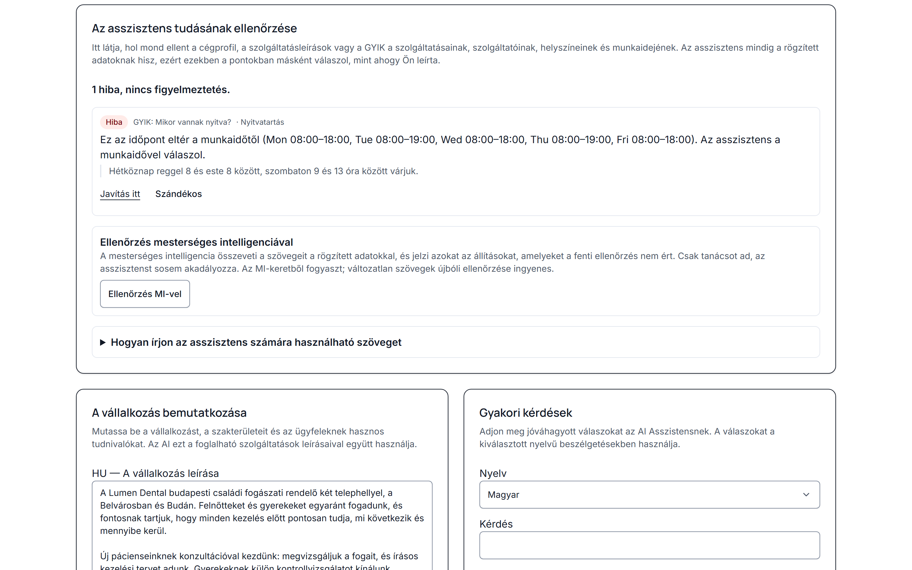

A szerkesztők felett található **az asszisztens tudásának ellenőrzése**: egy lista minden olyan helyről, ahol a szövegei ellentmondanak a rögzített adatoknak, mindegyik **Hiba** vagy **Figyelmeztetés** jelzéssel, a forrásszöveggel és egy **Javítás itt** linkkel. Többek között ezeket veszi észre:

- kínálatként felsorolt kezelés, amely **nem foglalható**;
- megnevezett személy, aki **nem foglalható szolgáltató**;
- olyan **város**, ahol nincs helyszínük;
- a szövegbe írt **nyitvatartás** — még ha helyes is, mert el fog avulni;
- olyan **ár**, amely egyetlen szolgáltatáson sincs beállítva, vagy ugyanaz az ár két helyen;
- **hiányzó nyelv** — nincs bemutatkozás, szolgáltatásfordítás vagy GYIK egy olyan nyelven, amelyen az asszisztens beszél;
- **ügyfél neve** egy véleményben, amelyet az asszisztens bárkinek megismételhet;
- **hiányzó kapcsolattartási e-mail vagy telefonszám**, illetve olyan szolgáltató, aki kínál szolgáltatást, de **nincs munkaideje**.

Egyes jelzések szándékosak — valóban említ egy kezelést, amelyet a konzultáción terveznek meg. Nyomja meg a **Szándékos** gombot, és onnantól nem számít hibának. Ha később átfogalmazza a szöveget, a jelzés visszatér, mert Ön azt a megfogalmazást hagyta jóvá.

> **Amíg megoldatlan hiba van, az asszisztens nem kapcsolható be.** Javítsa ki mindegyiket, vagy jelölje szándékosnak. Ha már működik, egy újonnan felmerülő hiba soha nem kapcsolja ki — az AI Asszisztens képernyő jelzi, hogy van mit megnézni, az ügyfeleket pedig továbbra is kiszolgálja.

Az ellenőrzés azt is megmutatja, **hogyan írjon az asszisztens számára használható szöveget** — nyolc rövid szabály:

| Szabály                | Egy mondatban                                                                               |
| ---------------------- | ------------------------------------------------------------------------------------------- |
| **Kínálat**            | Csak foglalható szolgáltatást soroljon fel kínálatként, vagy írja le, hogyan érhető el      |
| **Személyek**          | Csak foglalható szolgáltatót nevezzen meg; mást a szerepével együtt                         |
| **Helyszín**           | A város és a cím a Helyszínekből jön; ha a szövegben is szerepel, egyezzen                  |
| **Nyitvatartás**       | Ne írja a nyitvatartást a szövegbe — az asszisztens a munkaidőből olvassa                   |
| **Árak**               | Az ár a szolgáltatáshoz tartozik; az asszisztens csak az ott beállított árat mondja meg     |
| **Egy tény, egy hely** | Ami egy szolgáltatásra vonatkozik, az annak a leírásába kerüljön, ne a bemutatkozásba is    |
| **Nyelvek**            | Minden nyelvhez, amelyen az asszisztens beszél, legyen saját bemutatkozás, fordítás és GYIK |
| **Személyes adatok**   | Ne szerepeljenek ügyfélnevek, például véleményekben                                         |

Az **Ellenőrzés MI-vel** egy lépéssel tovább megy: megkéri az AI-t, hogy vesse össze a szövegeit a rögzített adatokkal, és mutasson rá azokra az állításokra, amelyeket az automatikus ellenőrzés nem ért. Ez **tanácsadó jellegű** — soha nem tiltja le az asszisztenst —, és az AI-keretet használja; változatlan szövegekre újra futtatva ingyenes.

### A beszélgetések olvasása

Minden átirat az AI Asszisztens képernyőn található. Ha egy válasz **olyat említett, ami nincs a rögzített adatok között** — kezelést, személyt, árat —, az üzenet meg van jelölve:

> _Ez a válasz olyat említett, ami nincs a rögzített adatok között: {értékek}. Az ügyfél így látta._

Egy ilyen jelzés szinte mindig a tudásellenőrzéshez vezet vissza: egy szöveghez, amely olyasmit sugallt, amit a rögzített adatok nem támasztanak alá. Javítsa a szöveget, és a következő ügyfél már helyes választ kap.

---

## A munkatársi alkalmazás — a telefonján

Alkalmazásboltból semmit nem kell letölteni. A booking-and-more a böngészőből telepíthető a kezdőképernyőre, tulajdonosoknak, szolgáltatóknak és asszisztenseknek egyaránt.

- **Telepítés** a vállalkozása munkatársi oldaláról — `…/azonosito/install/staff`, vagy az általunk adott munkatársi QR-kóddal. A böngésző megerősítést kér. iPhone-on vagy iPaden: nyissa meg az oldalt **Safariban**, koppintson a **Megosztás**, majd a **Hozzáadás a kezdőképernyőhöz** lehetőségre.
- **A vállalkozása saját munkatársi belépését nyitja meg** — _„Munkatársi belépés · {vállalkozás}”_ —, majd a munkafelületét. Ha a fiók nem tagja annak a vállalkozásnak, ezt jelzi, és felajánlja a kijelentkezést.
- **Internetkapcsolat kell hozzá.** Kapcsolat nélkül elavult időpontok helyett egy értesítést és egy _Próbálja újra_ gombot mutat.

A telepítés nem kötelező — böngészőben ugyanúgy minden működik.

**Az ügyfeleknek soha nem kell semmit telepíteniük.** A páciens QR-kódok közvetlenül a böngészőjükben nyitják meg a foglalási oldalt vagy a chatet.

---

## Nyelvek és időzónák

**Két felületi nyelv:** magyar és angol. Mindenki a nyelvváltóval választja ki a sajátját — ez senki más számára nem változtat semmit. Az ügyfelek a foglalási oldalt és minden e-mailt a vállalkozás beállított nyelvén kapják, vagy azon, amelyre átváltanak.

**Négy tartalmi nyelv:** a szolgáltatások neve és leírása, a bemutatkozás és a GYIK egyaránt vezethető magyarul, angolul, németül és franciául, és az AI recepciós mind a négy nyelven chatel.

A szolgáltatók emellett megadhatják a **beszélt nyelveiket** — magyar, angol, német vagy francia —, hogy az ügyfelek könnyebben válasszanak.

**Az időzónákról** két szabály:

- **A munkaidő faliórás idő.** A „hétfőnként 09:00–17:00” óraátállítás után is 09:00–17:00 marad.
- **Egy konkrét időpont egy pillanat az időben.** Egy másik országban lévő ügyfél a saját órája szerint, helyesen látja, mindkét irányban.

Erre soha nem kell gondolnia — de ezért mutatja meg az elérhetőség képernyő, melyik időzónában ad meg időt.

---

## Ha a foglalási oldal semmit nem kínál

A leggyakoribb kérdés, és szinte mindig néhány egyszerű ok áll mögötte. Haladjon végig ezen a listán:

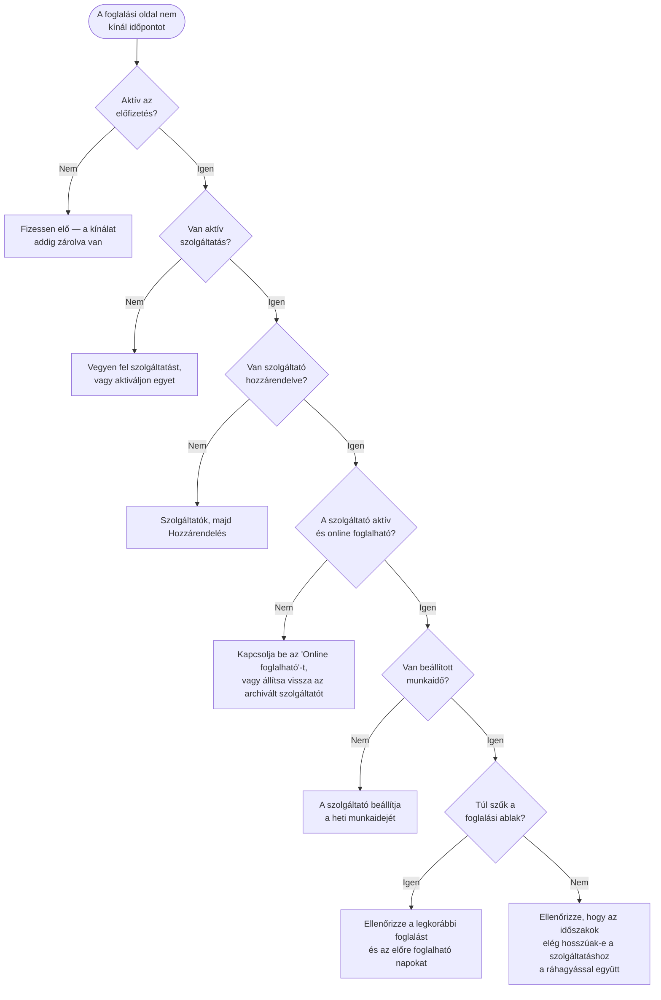

A két leggyakoribb buktató:

**Szolgáltató munkaidővel, de hozzárendelt szolgáltatás nélkül.** A naptára tökéletesen beállítottnak tűnik, mégsem lehet hozzá foglalni, mert egy foglalás mindig _egy szolgáltatásra_ szól. A sorában lévő **Hozzárendelés** gombbal javítható. Az Elérhetőség képernyő ezt már megnyitáskor jelzi.

**A szolgáltatás és a ráhagyás együtt hosszabb, mint a munkaidő-szakasz.** Egy 30 perces szolgáltatás mindkét oldalon 10 perc ráhagyással 50 perces ablakot igényel. Egy 09:00–09:45 időszak bőségesnek tűnik, mégsem fér bele semmi.

Ha egy szolgáltatás **előre foglalható napjainak** száma nagyon alacsony, a képernyő azonnal figyelmeztet — _„Csak a következő {n} nap lesz foglalható”_ —, mert ezt könnyű elgépelni.

Az AI recepciós pontosan azokat az időpontokat kínálja, mint a foglalási oldal, így ha az oldal semmit nem mutat, a chat sem fog — ha itt javítja, mindkettő rendbe jön.

---

## Egy jól bevált beállítási sorrend

1. **Fogadja el a meghívót**, és válasszon jelszót.
2. **Fizessen elő** — válasszon csomagot, kövesse az e-mailben kapott fizetési linket, indítsa el a próbaidőszakot.
3. **Vegye fel a szolgáltatásokat** — időtartam, ráhagyás, ár, és hogy melyik igényel jóváhagyást.
4. **Vegye fel a helyszíneket** — teljesen kihagyhatja, ha csak online vagy telefonon dolgozik.
5. **Vegye fel a szolgáltatókat**, és mindegyiknél használja a **Hozzárendelés** gombot. Ezt ne hagyja ki. Ha maga is rendel, vegye fel magát is, és az Áttekintésen rendelje hozzá a naptárát.
6. **Hívja meg a szolgáltatókat** a saját sorukból, hogy minden meghívó magával vigye a naptárat.
7. **Minden szolgáltató beállítja a munkaidejét** az Elérhetőség képernyőn.
8. **Hívja meg a recepciót** azoknak a naptáraknak a Megbízottak fülén, amelyeket kezelni fognak.
9. **Nyissa meg saját maga a foglalási oldalt**, és foglaljon egy próbaidőpontot az elejétől a végéig.
10. **Professional csomagban:** töltse ki az elérhetőségeket, a bemutatkozást és a GYIK-et az Áttekintésen, oldja meg a tudásellenőrzés hibáit, majd kapcsolja be az asszisztenst, és próbáljon ki egy beszélgetést.
11. **Ossza meg a linkeket** — töltse le a QR-kódokat, tegye ki őket a weboldalára és az ajtajára, és helyezze el a chatbuborékot a weboldalán.

---

## Jó szokások

- **Archiváljon, ne hozzon létre újra.** Ha egy nevet elutasít a rendszer, jelölje be az _Archiváltak megjelenítése_ lehetőséget, és inkább állítsa vissza — így a foglalási előzmények helyesek maradnak.
- **A ráhagyást a szolgáltatáson adja meg, ne az időtartamban.** Az ügyfél az időpontja valódi hosszát lássa; az előkészítés ideje az Öné.
- **Hagyja, hogy a szolgáltatók maguk kezeljék a munkaidejüket.** Ők tudják, mikor vannak távol, és a képernyő nekik készült.
- **Szűken adjon megbízást.** A recepciónak a _Foglalások_ hatáskört adja meg azoknál a naptáraknál, amelyeket kezel. Az _Elérhetőség_ hatáskört csak ott, ahol valóban ők kezelik valakinek a beosztását.
- **Nézze meg a Beosztáson kívül jelzést** minden beosztásmódosítás után. Ez az egyetlen dolog, amelyről senki nem kap e-mailt.
- **A tények a rögzített adatokba valók, ne a szövegbe.** Nyitvatartás a munkaidőben, ár a szolgáltatáson, cím a helyszínen. Az asszisztens a rögzített adatoknak hisz, és ami nincs megismételve a szövegben, az ott el sem avulhat.
- **Olvasson el hetente néhány átiratot.** Egy megjelölt válasz öt perc alatt javítható szöveghibát jelez, amely különben a következő ügyfelet is félrevezetné.
- **Teszteljen egy valódi foglalással** — Professional csomagban egy valódi beszélgetéssel is —, mielőtt megosztja a linket. Öt perc, és minden fenti hibát kiszűr.
